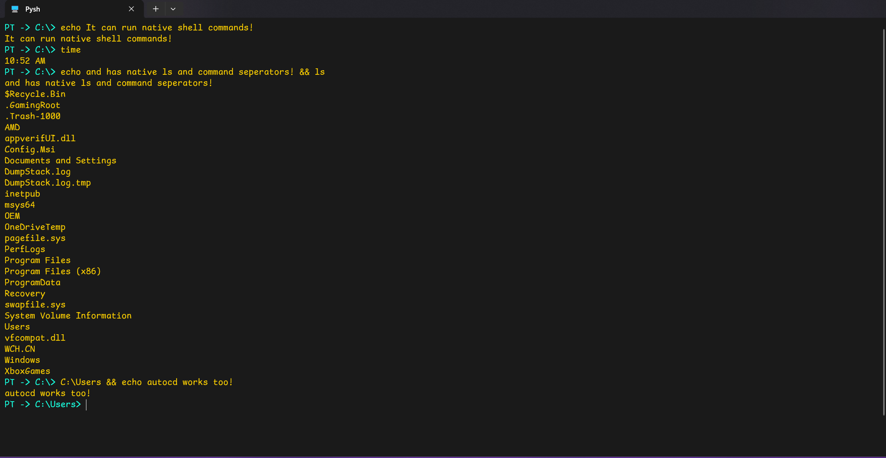

# Pysh (PYthon SHell)

## This is a shell coded entirely in Python

 Pysh is a Python-based shell tailored for Python development

Reasons to use Pysh:

1. It has tools for Python development;
2. It is cross-platform;
3. It has native uv support;
4. Self-updating;
5. It can run *.py and *.pysh files natively;
6. And it is customizable.

## Pythoner

Pythoner is another related project. It is a custom Python REPL designed to combine Python and package handling in one tool.<br>
It was extracted from pysh.<br>
[More details here](https://pypi.org/project/Pythoner/)

## Installation

[To install Pysh, click this link and find your OS release](https://github.com/cadeymatignas-source/pysh/releases/latest). <br>
Alternatively, you can run the `pyshupdate` CLI included in the zip file.
```bash
pyshupdate
```
For Pythoner, just run this:
```bash
pip install pythoner
```
